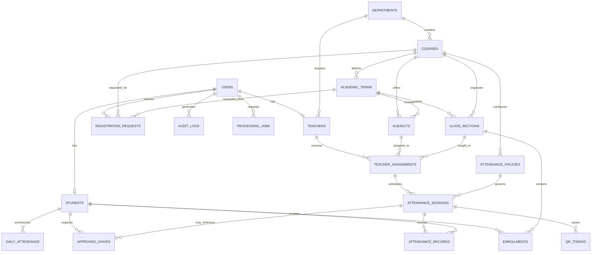

# Smart Attendance Management System
## Final Database Design and Physical Schema Specification

**Document Version:** 1.0  
**Database:** `smart_attendance_db`  
**Database Engine:** MySQL 8.x  
**Storage Engine:** InnoDB  
**Character Set:** `utf8mb4`  
**Collation:** `utf8mb4_0900_ai_ci`  
**Project Type:** Web-based College Attendance Management System  
**Attendance Method:** Dynamic QR Code  
**Deployment:** Local  

---

# 1. Project Overview

The Smart Attendance Management System is designed to manage student registration, academic structures, teacher assignments, QR-based attendance, leave management, and attendance reports.

The system supports:

- Student and teacher accounts.
- Admin-managed and self-service student registration.
- Flexible academic terms, including semesters, years, trimesters, and custom terms.
- Course, section, and subject management.
- Teacher-to-subject and section assignments.
- QR-based attendance with a 60-second token rotation.
- Configurable late-arrival grace periods.
- Subject-wise and daily attendance calculations.
- Approved leave handling using the `EXCUSED` attendance status.
- Audit logging and background processing.

## 1.1 Technology Responsibilities

| Component | Responsibility |
|---|---|
| React frontend | User interface, QR display, QR scanning and dashboards |
| Spring Boot backend | Authentication, authorization, validation and authoritative database operations |
| MySQL 8.x | Persistent storage |
| Python FastAPI service | Internal background processing and analytics |
| Local environment | Application and database deployment |

**Important:** Spring Boot is the authoritative owner of business data. The Python service should receive authorized processing tasks through the backend and should not have unrestricted direct access to the database.

# 2. Database Design Principles

1. Use normalized relational tables to reduce unnecessary duplication.
2. Use foreign keys to maintain referential integrity.
3. Preserve attendance history instead of physically deleting historical records.
4. Use status fields for deactivation and retirement.
5. Use unique constraints to prevent duplicate accounts and attendance records.
6. Store timestamps in UTC and convert them to the institution's timezone when displaying them.
7. Store QR token hashes instead of raw QR tokens.
8. Store session-specific attendance policy values as snapshots so that later policy changes do not alter historical sessions.
9. Calculate attendance summaries from finalized attendance records.
10. Use database transactions for operations that affect multiple related tables.

# 3. Database Conventions

| Item | Convention |
|---|---|
| Primary key | `BIGINT UNSIGNED AUTO_INCREMENT` |
| Foreign key | `BIGINT UNSIGNED` |
| Text encoding | `utf8mb4` |
| Storage engine | InnoDB |
| Date | `DATE` |
| Timestamp | `DATETIME(3)` |
| Boolean | `BOOLEAN` |
| Percentage | `DECIMAL(5,2)` |
| Flexible metadata | `JSON` |
| Long error message | `TEXT` |
| Status values | `VARCHAR` |
| Default application timezone | `Asia/Kolkata` |
| Stored timestamp timezone | UTC |

All tables should have an auto-incrementing primary key unless explicitly specified otherwise.

Most operational tables should contain `created_at` and `updated_at` timestamps. These timestamps should be maintained consistently by the application.

# 4. Database Table Inventory

The database contains **19 tables**, divided into six logical modules.

| Module | Tables |
|---|---|
| Identity and Access | `users`, `students`, `teachers`, `registration_requests` |
| Academic Structure | `departments`, `courses`, `academic_terms`, `class_sections`, `subjects` |
| Enrollment and Assignments | `enrollments`, `teacher_assignments` |
| Attendance | `attendance_policies`, `attendance_sessions`, `qr_tokens`, `attendance_records`, `daily_attendance`, `approved_leaves` |
| System Operations | `audit_logs`, `processing_jobs` |

---

# 5. Detailed Table Specifications

## 5.1 Identity and Access Management

### 5.1.1 `users`

Stores authentication details and account-level information for all system users.

| Column | Data Type | Constraints | Description |
|---|---|---|---|
| `id` | BIGINT UNSIGNED | PK, AI | Unique user ID |
| `email` | VARCHAR(190) | NOT NULL, UNIQUE | Login email |
| `password_hash` | VARCHAR(255) | NOT NULL | Hashed password |
| `role` | VARCHAR(20) | NOT NULL | ADMIN, TEACHER, STUDENT |
| `account_status` | VARCHAR(20) | NOT NULL | PENDING, ACTIVE, INACTIVE, SUSPENDED |
| `email_verified` | BOOLEAN | NOT NULL, DEFAULT FALSE | Email verification status |
| `last_login_at` | DATETIME(3) | NULL | Last successful login |
| `created_at` | DATETIME(3) | NOT NULL | Creation timestamp |
| `updated_at` | DATETIME(3) | NOT NULL | Last update timestamp |

**Indexes:**
- UNIQUE (`email`)
- INDEX (`role`, `account_status`)

**Relationships:**
- One user can have one student profile.
- One user can have one teacher profile.
- One user can create a registration request.
- One user can be referenced by audit and processing records.

A user's account should be deactivated rather than physically deleted when historical records exist.

### 5.1.2 `students`

Stores student-specific personal and academic identity information.

| Column | Data Type | Constraints | Description |
|---|---|---|---|
| `id` | BIGINT UNSIGNED | PK, AI | Student ID |
| `user_id` | BIGINT UNSIGNED | FK, UNIQUE, NOT NULL | Reference to `users.id` |
| `roll_number` | VARCHAR(40) | UNIQUE, NOT NULL | Student roll number |
| `admission_number` | VARCHAR(50) | UNIQUE, NULL | Admission identifier |
| `first_name` | VARCHAR(100) | NOT NULL | First name |
| `last_name` | VARCHAR(100) | NULL | Last name |
| `date_of_birth` | DATE | NULL | Date of birth |
| `admission_date` | DATE | NOT NULL | Admission date |
| `phone_number` | VARCHAR(20) | NULL | Contact number |
| `created_at` | DATETIME(3) | NOT NULL | Creation timestamp |
| `updated_at` | DATETIME(3) | NOT NULL | Last update timestamp |

**Indexes:**
- UNIQUE (`user_id`)
- UNIQUE (`roll_number`)
- UNIQUE (`admission_number`)

**Relationships:**
- Each student profile belongs to one user.
- A student can have multiple enrollments over time.
- A student can have multiple attendance records and leave requests.

**Design assumption:** Roll numbers are institution-wide unique. If the institution reuses roll numbers between courses or admission batches, this constraint must be changed to a suitable scoped uniqueness rule before implementation.

### 5.1.3 `teachers`

Stores teacher and faculty information.

| Column | Data Type | Constraints | Description |
|---|---|---|---|
| `id` | BIGINT UNSIGNED | PK, AI | Teacher ID |
| `user_id` | BIGINT UNSIGNED | FK, UNIQUE, NOT NULL | Reference to `users.id` |
| `employee_id` | VARCHAR(40) | UNIQUE, NOT NULL | Employee identifier |
| `first_name` | VARCHAR(100) | NOT NULL | First name |
| `last_name` | VARCHAR(100) | NULL | Last name |
| `designation` | VARCHAR(100) | NULL | Faculty designation |
| `department_id` | BIGINT UNSIGNED | FK, NULL | Reference to `departments.id` |
| `created_at` | DATETIME(3) | NOT NULL | Creation timestamp |
| `updated_at` | DATETIME(3) | NOT NULL | Last update timestamp |

**Indexes:**
- UNIQUE (`user_id`)
- UNIQUE (`employee_id`)
- INDEX (`department_id`)

**Relationships:**
- Each teacher belongs to one user account.
- A teacher may belong to a department.
- A teacher can have multiple subject assignments.

### 5.1.4 `registration_requests`

Stores student self-registration requests awaiting administrative approval.

| Column | Data Type | Constraints | Description |
|---|---|---|---|
| `id` | BIGINT UNSIGNED | PK, AI | Request ID |
| `user_id` | BIGINT UNSIGNED | FK, UNIQUE, NOT NULL | Applicant account |
| `requested_roll_number` | VARCHAR(40) | NOT NULL | Requested roll number |
| `requested_admission_number` | VARCHAR(50) | NULL | Requested admission number |
| `requested_course_id` | BIGINT UNSIGNED | FK, NOT NULL | Requested course |
| `requested_term_id` | BIGINT UNSIGNED | FK, NULL | Requested academic term |
| `first_name` | VARCHAR(100) | NOT NULL | Applicant's first name |
| `last_name` | VARCHAR(100) | NULL | Applicant's last name |
| `status` | VARCHAR(20) | NOT NULL | PENDING, APPROVED, REJECTED |
| `reviewed_by` | BIGINT UNSIGNED | FK, NULL | Admin who reviewed the request |
| `reviewed_at` | DATETIME(3) | NULL | Review timestamp |
| `rejection_reason` | VARCHAR(500) | NULL | Reason for rejection |
| `created_at` | DATETIME(3) | NOT NULL | Request creation timestamp |

**Indexes:**
- UNIQUE (`user_id`)
- INDEX (`status`, `created_at`)
- INDEX (`requested_roll_number`)

**Relationships:**
- Each request belongs to one user.
- Each request references a requested course.
- An optional academic term may be specified.
- The reviewing administrator is referenced through `reviewed_by`.

**Registration workflow:** The applicant selects a course and optionally a term. The administrator assigns the student to an appropriate class section during approval. The request does not directly create an enrollment until approval succeeds.

---

## 5.2 Academic Structure

### 5.2.1 `departments`

Stores institution departments.

| Column | Data Type | Constraints | Description |
|---|---|---|---|
| `id` | BIGINT UNSIGNED | PK, AI | Department ID |
| `department_code` | VARCHAR(30) | UNIQUE, NOT NULL | Department code |
| `department_name` | VARCHAR(150) | NOT NULL | Department name |
| `description` | VARCHAR(500) | NULL | Department description |
| `status` | VARCHAR(20) | NOT NULL | ACTIVE, INACTIVE |
| `created_at` | DATETIME(3) | NOT NULL | Creation timestamp |
| `updated_at` | DATETIME(3) | NOT NULL | Last update timestamp |

**Indexes:**
- UNIQUE (`department_code`)

**Relationships:**
- One department can contain multiple courses.
- One department can have multiple teachers.

### 5.2.2 `courses`

Stores academic programmes such as BCA, BBA, B.Tech, and other courses.

| Column | Data Type | Constraints | Description |
|---|---|---|---|
| `id` | BIGINT UNSIGNED | PK, AI | Course ID |
| `department_id` | BIGINT UNSIGNED | FK, NOT NULL | Parent department |
| `course_code` | VARCHAR(30) | UNIQUE, NOT NULL | Course code |
| `course_name` | VARCHAR(150) | NOT NULL | Course name |
| `duration_years` | DECIMAL(3,1) | NOT NULL | Course duration |
| `description` | VARCHAR(500) | NULL | Course description |
| `status` | VARCHAR(20) | NOT NULL | ACTIVE, INACTIVE |
| `created_at` | DATETIME(3) | NOT NULL | Creation timestamp |
| `updated_at` | DATETIME(3) | NOT NULL | Last update timestamp |

**Indexes:**
- UNIQUE (`course_code`)
- INDEX (`department_id`)

**Relationships:**
- Each course belongs to one department.
- A course can have multiple academic terms and subjects.

### 5.2.3 `academic_terms`

Stores flexible academic periods. The design does not assume that every institution uses semesters.

| Column | Data Type | Constraints | Description |
|---|---|---|---|
| `id` | BIGINT UNSIGNED | PK, AI | Academic term ID |
| `course_id` | BIGINT UNSIGNED | FK, NOT NULL | Parent course |
| `term_code` | VARCHAR(30) | NOT NULL | Term identifier |
| `term_name` | VARCHAR(100) | NOT NULL | Display name |
| `term_type` | VARCHAR(20) | NOT NULL | SEMESTER, YEAR, TRIMESTER, CUSTOM |
| `sequence_number` | SMALLINT UNSIGNED | NOT NULL | Term order |
| `academic_year_label` | VARCHAR(20) | NOT NULL | Academic year label |
| `start_date` | DATE | NOT NULL | Start date |
| `end_date` | DATE | NOT NULL | End date |
| `status` | VARCHAR(20) | NOT NULL | PLANNED, ACTIVE, COMPLETED, INACTIVE |
| `created_at` | DATETIME(3) | NOT NULL | Creation timestamp |
| `updated_at` | DATETIME(3) | NOT NULL | Last update timestamp |

**Unique constraints:**
- (`course_id`, `term_code`, `academic_year_label`)
- (`course_id`, `sequence_number`, `academic_year_label`)

**Checks:**
- `end_date` must be on or after `start_date`.

**Relationships:**
- Each academic term belongs to one course.
- An academic term can contain multiple sections and subjects.

### 5.2.4 `class_sections`

Stores class divisions within a course and academic term.

| Column | Data Type | Constraints | Description |
|---|---|---|---|
| `id` | BIGINT UNSIGNED | PK, AI | Section ID |
| `course_id` | BIGINT UNSIGNED | FK, NOT NULL | Parent course |
| `term_id` | BIGINT UNSIGNED | FK, NOT NULL | Academic term |
| `section_name` | VARCHAR(30) | NOT NULL | Section name |
| `room_number` | VARCHAR(30) | NULL | Classroom |
| `status` | VARCHAR(20) | NOT NULL | ACTIVE, INACTIVE |
| `created_at` | DATETIME(3) | NOT NULL | Creation timestamp |
| `updated_at` | DATETIME(3) | NOT NULL | Last update timestamp |

**Unique constraint:**
- (`term_id`, `section_name`)

**Indexes:**
- INDEX (`course_id`)
- INDEX (`term_id`)

**Relationships:**
- Each section belongs to one course and one academic term.
- A section can contain multiple student enrollments.
- A section can have multiple teacher assignments.

**Integrity requirement:** The selected term must belong to the selected course. This should be enforced through a composite foreign key or equivalent database-level integrity design.

### 5.2.5 `subjects`

Stores subjects offered within a course and academic term.

| Column | Data Type | Constraints | Description |
|---|---|---|---|
| `id` | BIGINT UNSIGNED | PK, AI | Subject ID |
| `course_id` | BIGINT UNSIGNED | FK, NOT NULL | Parent course |
| `term_id` | BIGINT UNSIGNED | FK, NOT NULL | Academic term |
| `subject_code` | VARCHAR(30) | NOT NULL | Subject code |
| `subject_name` | VARCHAR(150) | NOT NULL | Subject name |
| `subject_type` | VARCHAR(20) | NOT NULL | THEORY, PRACTICAL, PROJECT, OTHER |
| `credits` | DECIMAL(4,1) | NULL | Subject credits |
| `description` | VARCHAR(500) | NULL | Subject description |
| `status` | VARCHAR(20) | NOT NULL | ACTIVE, INACTIVE |
| `created_at` | DATETIME(3) | NOT NULL | Creation timestamp |
| `updated_at` | DATETIME(3) | NOT NULL | Last update timestamp |

**Unique constraint:**
- (`term_id`, `subject_code`)

**Indexes:**
- INDEX (`course_id`, `term_id`)

**Relationships:**
- Each subject belongs to one course and one academic term.
- A subject can have multiple teacher assignments.

The course and term combination must be consistent.

---

## 5.3 Enrollment and Teacher Assignments

### 5.3.1 `enrollments`

Connects students to class sections.

| Column | Data Type | Constraints | Description |
|---|---|---|---|
| `id` | BIGINT UNSIGNED | PK, AI | Enrollment ID |
| `student_id` | BIGINT UNSIGNED | FK, NOT NULL | Student |
| `section_id` | BIGINT UNSIGNED | FK, NOT NULL | Class section |
| `enrollment_date` | DATE | NOT NULL | Enrollment date |
| `withdrawal_date` | DATE | NULL | Withdrawal date |
| `status` | VARCHAR(20) | NOT NULL | ACTIVE, COMPLETED, WITHDRAWN |
| `created_at` | DATETIME(3) | NOT NULL | Creation timestamp |
| `updated_at` | DATETIME(3) | NOT NULL | Last update timestamp |

**Unique constraint:**
- (`student_id`, `section_id`)

**Indexes:**
- INDEX (`section_id`, `status`)
- INDEX (`student_id`)

**Relationships:**
- Each enrollment belongs to one student and one section.
- A student can have multiple enrollments over their academic history.

### 5.3.2 `teacher_assignments`

Connects teachers with subjects and class sections.

| Column | Data Type | Constraints | Description |
|---|---|---|---|
| `id` | BIGINT UNSIGNED | PK, AI | Assignment ID |
| `teacher_id` | BIGINT UNSIGNED | FK, NOT NULL | Teacher |
| `subject_id` | BIGINT UNSIGNED | FK, NOT NULL | Subject |
| `section_id` | BIGINT UNSIGNED | FK, NOT NULL | Class section |
| `assigned_at` | DATETIME(3) | NOT NULL | Assignment timestamp |
| `assignment_end_date` | DATE | NULL | Assignment end date |
| `status` | VARCHAR(20) | NOT NULL | ACTIVE, INACTIVE, COMPLETED |
| `created_at` | DATETIME(3) | NOT NULL | Creation timestamp |
| `updated_at` | DATETIME(3) | NOT NULL | Last update timestamp |

**Indexes:**
- INDEX (`teacher_id`, `status`)
- INDEX (`subject_id`, `section_id`)

**Relationships:**
- Each assignment belongs to one teacher, one subject, and one section.
- One assignment can have multiple attendance sessions.

**Integrity requirement:** The subject's academic term must match the section's academic term. Duplicate active assignments should be prevented by application validation.

---

## 5.4 Attendance Management

### 5.4.1 `attendance_policies`

Stores attendance configuration at institution or course level.

| Column | Data Type | Constraints | Description |
|---|---|---|---|
| `id` | BIGINT UNSIGNED | PK, AI | Policy ID |
| `course_id` | BIGINT UNSIGNED | FK, NULL | Course-specific policy; NULL means institution default |
| `grace_period_minutes` | SMALLINT UNSIGNED | NOT NULL | Allowed late-arrival period |
| `qr_rotation_seconds` | SMALLINT UNSIGNED | NOT NULL | QR token validity period |
| `allow_manual_attendance` | BOOLEAN | NOT NULL, DEFAULT TRUE | Manual marking permission |
| `daily_calculation_enabled` | BOOLEAN | NOT NULL, DEFAULT TRUE | Daily summary calculation |
| `effective_from` | DATE | NOT NULL | Policy start date |
| `effective_until` | DATE | NULL | Policy end date |
| `status` | VARCHAR(20) | NOT NULL | ACTIVE, INACTIVE |
| `created_at` | DATETIME(3) | NOT NULL | Creation timestamp |
| `updated_at` | DATETIME(3) | NOT NULL | Last update timestamp |

**Indexes:**
- INDEX (`course_id`)
- INDEX (`effective_from`, `effective_until`)

**Initial configuration proposal:**
- QR rotation: 60 seconds.
- Grace period: 5 minutes, configurable.
- Manual attendance: enabled.
- Daily attendance calculation: enabled.

The five-minute grace period is a proposed default, not a fixed institutional rule. Administrators should be able to configure it.

Overlapping active policies for the same scope should be prevented.

### 5.4.2 `attendance_sessions`

Represents an individual scheduled class attendance session.

| Column | Data Type | Constraints | Description |
|---|---|---|---|
| `id` | BIGINT UNSIGNED | PK, AI | Session ID |
| `teacher_assignment_id` | BIGINT UNSIGNED | FK, NOT NULL | Related teacher assignment |
| `attendance_policy_id` | BIGINT UNSIGNED | FK, NULL | Applied policy |
| `session_date` | DATE | NOT NULL | Session date |
| `scheduled_start_at` | DATETIME(3) | NOT NULL | Scheduled start |
| `scheduled_end_at` | DATETIME(3) | NOT NULL | Scheduled end |
| `actual_start_at` | DATETIME(3) | NOT NULL | Actual session start |
| `closed_at` | DATETIME(3) | NULL | Session closure time |
| `grace_period_minutes` | SMALLINT UNSIGNED | NOT NULL | Grace period snapshot |
| `qr_rotation_seconds` | SMALLINT UNSIGNED | NOT NULL | QR rotation snapshot |
| `status` | VARCHAR(20) | NOT NULL | ACTIVE, CLOSED, CANCELLED |
| `cancellation_reason` | VARCHAR(500) | NULL | Cancellation explanation |
| `created_at` | DATETIME(3) | NOT NULL | Creation timestamp |
| `updated_at` | DATETIME(3) | NOT NULL | Last update timestamp |

**Indexes:**
- INDEX (`teacher_assignment_id`, `session_date`)
- INDEX (`session_date`, `status`)

**Checks:**
- Scheduled end must be later than scheduled start.
- Grace period cannot be negative.
- QR rotation must be greater than zero.

**Important:** Grace period and QR rotation are stored as snapshots. Changing the attendance policy later must not modify existing sessions.

### 5.4.3 `qr_tokens`

Stores issued QR token hashes and their validity periods.

| Column | Data Type | Constraints | Description |
|---|---|---|---|
| `id` | BIGINT UNSIGNED | PK, AI | Token record ID |
| `session_id` | BIGINT UNSIGNED | FK, NOT NULL | Related attendance session |
| `token_hash` | VARCHAR(64) | UNIQUE, NOT NULL | SHA-256 token hash |
| `issued_at` | DATETIME(3) | NOT NULL | Token issue time |
| `expires_at` | DATETIME(3) | NOT NULL | Token expiration time |
| `revoked_at` | DATETIME(3) | NULL | Revocation time |
| `created_at` | DATETIME(3) | NOT NULL | Creation timestamp |

**Indexes:**
- UNIQUE (`token_hash`)
- INDEX (`session_id`, `expires_at`)

**Security rules:**
- Generate cryptographically random QR tokens.
- Store only the SHA-256 hash of each token.
- Never store the original raw token in the database.
- Tokens expire according to the session's configured rotation interval.
- Expired or revoked tokens must be rejected.
- All active tokens must be revoked when a session closes.

A valid QR token can be used by multiple eligible students during its validity window. Duplicate attendance is prevented separately by the attendance record constraint.

### 5.4.4 `attendance_records`

Stores individual student attendance against a particular class session.

| Column | Data Type | Constraints | Description |
|---|---|---|---|
| `id` | BIGINT UNSIGNED | PK, AI | Attendance record ID |
| `session_id` | BIGINT UNSIGNED | FK, NOT NULL | Attendance session |
| `student_id` | BIGINT UNSIGNED | FK, NOT NULL | Student |
| `status` | VARCHAR(20) | NOT NULL | PRESENT, LATE, ABSENT, EXCUSED |
| `marking_method` | VARCHAR(20) | NOT NULL | QR, MANUAL, SYSTEM, LEAVE |
| `marked_at` | DATETIME(3) | NULL | Attendance marking time |
| `marked_by` | BIGINT UNSIGNED | FK, NULL | User who marked attendance |
| `remarks` | VARCHAR(500) | NULL | Additional notes |
| `created_at` | DATETIME(3) | NOT NULL | Creation timestamp |
| `updated_at` | DATETIME(3) | NOT NULL | Last update timestamp |

**Unique constraint:**
- (`session_id`, `student_id`)

**Indexes:**
- INDEX (`student_id`, `status`)
- INDEX (`session_id`, `status`)

**Relationships:**
- Each attendance record belongs to one session and one student.
- `marked_by` identifies the user responsible for marking the record when applicable.

**Business rules:**
- A student must be enrolled in the section associated with the session.
- One student can have only one attendance record per session.
- QR submissions determine PRESENT or LATE using the scheduled start and grace period.
- Students without a valid attendance submission receive ABSENT when the session is finalized, unless an approved leave applies.
- `marked_by` can be NULL for system-generated records.

### 5.4.5 `daily_attendance`

Stores a calculated daily attendance summary for each student.

| Column | Data Type | Constraints | Description |
|---|---|---|---|
| `id` | BIGINT UNSIGNED | PK, AI | Summary ID |
| `student_id` | BIGINT UNSIGNED | FK, NOT NULL | Student |
| `attendance_date` | DATE | NOT NULL | Attendance date |
| `total_sessions` | SMALLINT UNSIGNED | NOT NULL | Finalized qualifying sessions |
| `present_count` | SMALLINT UNSIGNED | NOT NULL | Present sessions |
| `late_count` | SMALLINT UNSIGNED | NOT NULL | Late sessions |
| `absent_count` | SMALLINT UNSIGNED | NOT NULL | Absent sessions |
| `excused_count` | SMALLINT UNSIGNED | NOT NULL | Excused sessions |
| `attendance_percentage` | DECIMAL(5,2) | NULL | Calculated percentage |
| `status` | VARCHAR(20) | NOT NULL | PRESENT, PARTIAL, ABSENT, EXCUSED |
| `calculated_at` | DATETIME(3) | NOT NULL | Calculation timestamp |
| `updated_at` | DATETIME(3) | NOT NULL | Last update timestamp |

**Unique constraint:**
- (`student_id`, `attendance_date`)

**Indexes:**
- INDEX (`attendance_date`, `status`)
- INDEX (`student_id`, `attendance_date`)

**Daily attendance calculation:**

Attendance percentage:

`((present_count + late_count) / (present_count + late_count + absent_count)) × 100`

Excused sessions are excluded from the denominator.

**Daily status rules:**

| Condition | Daily Status |
|---|---|
| All qualifying sessions attended | PRESENT |
| Some sessions attended and some missed | PARTIAL |
| No sessions attended, with at least one absence | ABSENT |
| All sessions are excused | EXCUSED |
| No finalized qualifying sessions | No summary record |

Only closed, non-cancelled sessions should contribute to the daily summary. An active session must not temporarily count as an absence.

This table is a derived summary. The detailed source of truth remains `attendance_records`.

### 5.4.6 `approved_leaves`

Stores student leave requests and administrative decisions.

| Column | Data Type | Constraints | Description |
|---|---|---|---|
| `id` | BIGINT UNSIGNED | PK, AI | Leave ID |
| `student_id` | BIGINT UNSIGNED | FK, NOT NULL | Student |
| `start_date` | DATE | NOT NULL | Leave start date |
| `end_date` | DATE | NOT NULL | Leave end date |
| `leave_scope` | VARCHAR(20) | NOT NULL | FULL_DAY, SESSION |
| `session_id` | BIGINT UNSIGNED | FK, NULL | Specific session for session leave |
| `reason` | VARCHAR(1000) | NULL | Leave reason |
| `status` | VARCHAR(20) | NOT NULL | PENDING, APPROVED, REJECTED, CANCELLED |
| `reviewed_by` | BIGINT UNSIGNED | FK, NULL | Reviewing administrator |
| `reviewed_at` | DATETIME(3) | NULL | Review timestamp |
| `created_at` | DATETIME(3) | NOT NULL | Creation timestamp |
| `updated_at` | DATETIME(3) | NOT NULL | Last update timestamp |

**Indexes:**
- INDEX (`student_id`, `start_date`, `end_date`)
- INDEX (`status`, `start_date`)
- INDEX (`session_id`)

**Checks and validation:**
- End date must be on or after start date.
- FULL_DAY leave must have a NULL `session_id`.
- SESSION leave must have a non-NULL `session_id`.
- A session-specific leave must reference a session relevant to that student.
- Pending and rejected leaves must not change attendance.

**Approved leave handling:**
- Approved leave creates or updates an applicable attendance record to EXCUSED.
- Daily attendance summaries must be recalculated.
- An approved leave must not automatically overwrite a legitimate PRESENT record. Conflicts should be flagged for administrative resolution.

---

## 5.5 System Operations

### 5.5.1 `audit_logs`

Stores important system activities for accountability and troubleshooting.

| Column | Data Type | Constraints | Description |
|---|---|---|---|
| `id` | BIGINT UNSIGNED | PK, AI | Audit ID |
| `user_id` | BIGINT UNSIGNED | FK, NULL | User responsible for the action |
| `action` | VARCHAR(100) | NOT NULL | Action name |
| `entity_type` | VARCHAR(100) | NULL | Affected entity type |
| `entity_id` | BIGINT UNSIGNED | NULL | Affected entity ID |
| `details` | JSON | NULL | Additional structured information |
| `ip_address` | VARCHAR(45) | NULL | IPv4 or IPv6 address |
| `created_at` | DATETIME(3) | NOT NULL | Action timestamp |

**Indexes:**
- INDEX (`user_id`, `created_at`)
- INDEX (`entity_type`, `entity_id`)
- INDEX (`action`, `created_at`)

**Design rules:**
- Audit logs are append-only.
- Normal users and application workflows must not modify or delete historical audit entries.
- Sensitive information, including passwords and raw authentication tokens, must never be logged.

### 5.5.2 `processing_jobs`

Stores background tasks requested by the application and processed by the Python service or other workers.

| Column | Data Type | Constraints | Description |
|---|---|---|---|
| `id` | BIGINT UNSIGNED | PK, AI | Job ID |
| `requested_by` | BIGINT UNSIGNED | FK, NULL | Requesting user |
| `job_type` | VARCHAR(50) | NOT NULL | Job category |
| `status` | VARCHAR(20) | NOT NULL | QUEUED, PROCESSING, COMPLETED, FAILED, CANCELLED |
| `input_payload` | JSON | NULL | Job input parameters |
| `result_summary` | JSON | NULL | Job result information |
| `error_message` | TEXT | NULL | Failure details |
| `requested_at` | DATETIME(3) | NOT NULL | Request timestamp |
| `started_at` | DATETIME(3) | NULL | Processing start |
| `completed_at` | DATETIME(3) | NULL | Processing completion |
| `updated_at` | DATETIME(3) | NOT NULL | Last update timestamp |

**Indexes:**
- INDEX (`status`, `requested_at`)
- INDEX (`requested_by`, `requested_at`)
- INDEX (`job_type`, `status`)

**Initial job types:**
- ATTENDANCE_ANALYTICS
- REPORT_GENERATION
- DATA_VALIDATION
- IMAGE_PROCESSING

FACE_RECOGNITION may be considered a future extension, but it is not part of the current QR-based attendance implementation.

---

# 6. Primary Key and Foreign Key Summary

All primary keys use `BIGINT UNSIGNED AUTO_INCREMENT`.

| Child Table | Foreign Key Column | Referenced Table | Referenced Column |
|---|---|---|---|
| students | user_id | users | id |
| teachers | user_id | users | id |
| teachers | department_id | departments | id |
| registration_requests | user_id | users | id |
| registration_requests | requested_course_id | courses | id |
| registration_requests | requested_term_id | academic_terms | id |
| registration_requests | reviewed_by | users | id |
| courses | department_id | departments | id |
| academic_terms | course_id | courses | id |
| class_sections | course_id | courses | id |
| class_sections | term_id | academic_terms | id |
| subjects | course_id | courses | id |
| subjects | term_id | academic_terms | id |
| enrollments | student_id | students | id |
| enrollments | section_id | class_sections | id |
| teacher_assignments | teacher_id | teachers | id |
| teacher_assignments | subject_id | subjects | id |
| teacher_assignments | section_id | class_sections | id |
| attendance_policies | course_id | courses | id |
| attendance_sessions | teacher_assignment_id | teacher_assignments | id |
| attendance_sessions | attendance_policy_id | attendance_policies | id |
| qr_tokens | session_id | attendance_sessions | id |
| attendance_records | session_id | attendance_sessions | id |
| attendance_records | student_id | students | id |
| attendance_records | marked_by | users | id |
| daily_attendance | student_id | students | id |
| approved_leaves | student_id | students | id |
| approved_leaves | session_id | attendance_sessions | id |
| approved_leaves | reviewed_by | users | id |
| audit_logs | user_id | users | id |
| processing_jobs | requested_by | users | id |

# 7. Unique Constraints Summary

| Table | Unique Constraint |
|---|---|
| users | email |
| students | user_id, roll_number, admission_number |
| teachers | user_id, employee_id |
| registration_requests | user_id |
| departments | department_code |
| courses | course_code |
| academic_terms | course_id + term_code + academic_year_label |
| academic_terms | course_id + sequence_number + academic_year_label |
| class_sections | term_id + section_name |
| subjects | term_id + subject_code |
| enrollments | student_id + section_id |
| qr_tokens | token_hash |
| attendance_records | session_id + student_id |
| daily_attendance | student_id + attendance_date |

Nullable unique columns, such as `admission_number`, can have multiple NULL values in MySQL. This allows students without an admission number to be stored.

# 8. Indexing Strategy

Indexes should support the most common application queries.

| Query Requirement | Recommended Index |
|---|---|
| User login | `users.email` |
| Find students by roll number | `students.roll_number` |
| Find students by admission number | `students.admission_number` |
| Find active users by role | `users(role, account_status)` |
| Find course terms | `academic_terms(course_id, academic_year_label)` |
| Find sections within a term | `class_sections(term_id, section_name)` |
| Find students in a section | `enrollments(section_id, status)` |
| Find teacher assignments | `teacher_assignments(teacher_id, status)` |
| Find sessions for a teacher assignment | `attendance_sessions(teacher_assignment_id, session_date)` |
| Validate QR token | `qr_tokens.token_hash` |
| Find records for a session | `attendance_records(session_id, student_id)` |
| Find student attendance history | `attendance_records(student_id, status)` |
| Find daily summaries | `daily_attendance(student_id, attendance_date)` |
| Find pending leave requests | `approved_leaves(status, start_date)` |
| Find audit history | `audit_logs(user_id, created_at)` |
| Find queued background jobs | `processing_jobs(status, requested_at)` |

InnoDB automatically creates indexes for foreign keys when a suitable index is not already available. Avoid adding redundant indexes without checking the existing index definitions and actual query patterns.

# 9. Entity Relationship Overview

The following diagram represents the main entity relationships. It is a logical overview; the detailed foreign key definitions in Sections 5 and 6 remain authoritative.

# 10. Data Deletion and Retention Policy

Historical attendance data must remain available for reporting, verification, and audit purposes.

## 10.1 RESTRICT Deletion

Physical deletion should be restricted when dependent historical records exist.

| Parent Table | Dependent Table(s) |
|---|---|
| users | students, teachers |
| departments | courses |
| courses | academic_terms, subjects |
| academic_terms | class_sections |
| students | enrollments, attendance_records, daily_attendance |
| class_sections | enrollments |
| teachers | teacher_assignments |
| subjects | teacher_assignments |
| teacher_assignments | attendance_sessions |
| attendance_sessions | qr_tokens, attendance_records |

## 10.2 SET NULL

Optional references to users should use SET NULL where preserving the historical record is more important than preserving the account relationship.

Examples:
- `teachers.department_id`
- `registration_requests.reviewed_by`
- `attendance_records.marked_by`
- `approved_leaves.reviewed_by`
- `audit_logs.user_id`
- `processing_jobs.requested_by`

`attendance_sessions.attendance_policy_id` should preferably remain RESTRICT-protected. Policies referenced by historical sessions should be retained and marked inactive rather than deleted.

## 10.3 Soft Deletion

Use status fields for records that should no longer be used.

Examples:
- Users: INACTIVE or SUSPENDED.
- Teachers: account deactivation.
- Students: retain profile and enrollment history.
- Courses: INACTIVE.
- Subjects: INACTIVE.
- Sections: INACTIVE.
- Policies: INACTIVE.

**No cascading deletion should be used for historical attendance records.**

# 11. Core Business Transactions

Operations affecting multiple tables must run within database transactions.

## 11.1 Student Registration Approval

1. Administrator reviews the registration request.
2. Validate the requested course and academic term.
3. Verify roll number and admission number uniqueness.
4. Select the appropriate class section.
5. Create the student profile.
6. Create the enrollment.
7. Activate the user's account.
8. Update the registration request to APPROVED.
9. Record the action in `audit_logs`.

All steps should succeed together or roll back together.

## 11.2 QR Attendance Submission

1. Student authenticates with the application.
2. Student scans the displayed QR code.
3. Backend validates the QR token hash.
4. Verify token expiration and revocation status.
5. Verify that the attendance session is active.
6. Verify that the student is enrolled in the relevant section.
7. Determine PRESENT or LATE using the scheduled start time and grace period.
8. Insert the attendance record.
9. Recalculate relevant summaries when appropriate.

The unique constraint on (`session_id`, `student_id`) prevents duplicate attendance records.

## 11.3 Session Closure

1. Teacher or authorized administrator closes the session.
2. Mark the session as CLOSED.
3. Revoke all active QR tokens for that session.
4. Identify enrolled students who do not have attendance records.
5. Generate ABSENT records for those students, except where an approved leave applies.
6. Recalculate daily attendance summaries.
7. Write an audit entry.

For large classes, absence generation should be processed in batches. The application must not treat the session as fully finalized until all required records have been processed.

## 11.4 Leave Approval

1. Student submits a leave request.
2. Administrator reviews the request.
3. If approved, identify affected sessions.
4. Apply EXCUSED status where appropriate.
5. Resolve conflicts with existing PRESENT records through administrative review.
6. Recalculate daily summaries.
7. Record the decision in the audit log.

## 11.5 Attendance Summary Recalculation

The detailed attendance records are the source of truth.

When attendance changes because of manual correction, leave approval, or session finalization, the corresponding daily summary must be recalculated.

The daily summary must not be treated as an independent attendance record.

# 12. Security and Data Integrity Requirements

1. Passwords must be stored using a modern password-hashing algorithm, not plain text or reversible encryption.
2. Raw QR tokens must never be stored in the database.
3. QR tokens must be cryptographically random and time-limited.
4. Every attendance submission must be authenticated and validated by the backend.
5. The backend must verify student enrollment before accepting attendance.
6. Unique constraints must prevent duplicate attendance.
7. Administrative actions must be recorded in audit logs.
8. SQL access must use parameterized operations through the backend's persistence layer.
9. The Python service must receive only the data and permissions required for its assigned processing task.
10. Sensitive credentials and secrets must not be stored in audit logs or job payloads.

# 13. Important Implementation Notes

The following requirements should be checked during implementation:

| Area | Requirement |
|---|---|
| Academic consistency | A section and subject must reference the same course and term combination |
| Registration | Admin selects the student's actual section during approval |
| Roll numbers | Confirm whether roll numbers are institution-wide unique |
| Attendance | Only enrolled students can receive attendance records |
| QR security | Validate token hash, expiry, session status and enrollment |
| Late marking | Use the session's stored grace period |
| Daily summary | Include only finalized, non-cancelled sessions |
| Leave | Approved leave is EXCUSED, not PRESENT |
| Policy changes | Existing sessions retain their policy snapshots |
| Historical data | Use soft deletion and restrictive foreign keys |
| Background jobs | Python processing must not bypass backend authorization |

# 14. Final Table Count

| Module | Number of Tables |
|---|---:|
| Identity and Access | 4 |
| Academic Structure | 5 |
| Enrollment and Assignments | 2 |
| Attendance | 6 |
| System Operations | 2 |
| **Total** | **19** |

# 15. Final Design Decisions and Assumptions

The following decisions define the current version of the database design.

| Decision | Final Specification |
|---|---|
| Database | MySQL 8.x |
| Storage engine | InnoDB |
| Attendance method | QR Code |
| QR token rotation | 60 seconds |
| Late attendance | Configurable grace period |
| Initial grace period | 5 minutes, provisional |
| Attendance calculation | Subject-wise and daily |
| Approved leave status | EXCUSED |
| Academic structure | Flexible academic terms |
| Student registration | Self-registration and admin registration |
| Student approval | Administrator assigns section |
| Deployment | Local |
| Backend ownership | Spring Boot |
| Python service | Background processing |
| Historical attendance | Retained; no cascading deletion |
| Attendance summary | Derived from finalized attendance records |

## Final Note

This document defines the proposed physical database structure for version 1.0 of the Smart Attendance Management System. Before creating the actual database, confirm the institution's roll-number uniqueness convention and the grace-period default. The schema should then be translated into SQL migrations and mapped to the application's entities and repositories.
